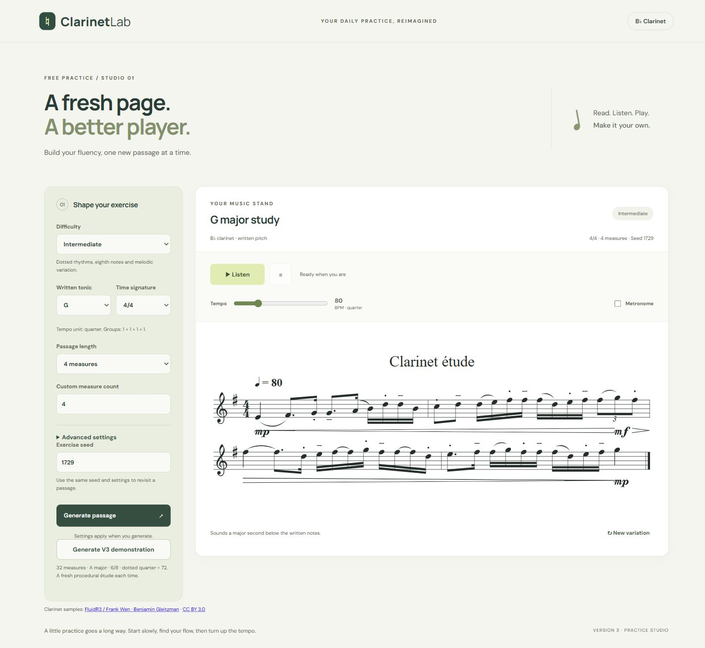
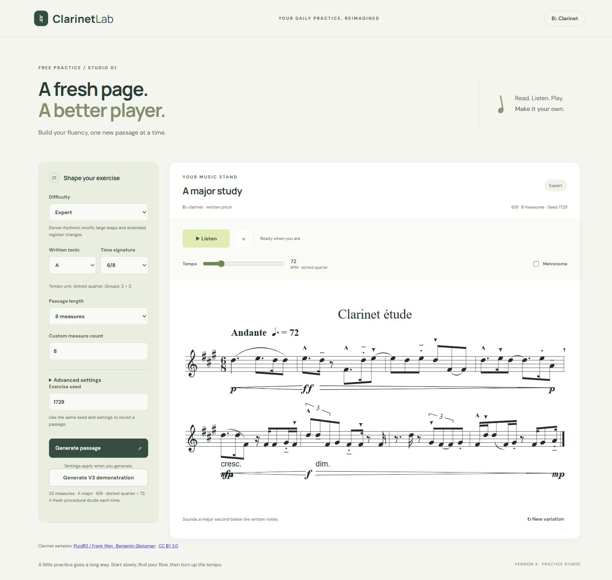
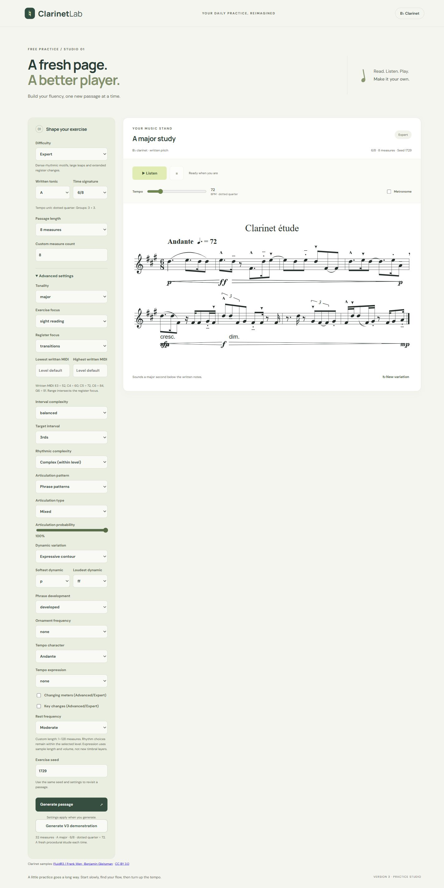

# ClarinetLab
A local React + TypeScript + Vite clarinet practice studio. PRODUCT_SPEC.md preserves the master vision; VERSION_3_SPEC.md defines the current music-engine extension.

## Screenshots

Actual Version 3 application captures from a 1440 × 900 desktop viewport. Full-page screenshots preserve the complete score and controls; exercises are generated locally, not mockups.

### Practice Studio

An intermediate G-major passage in 4/4, generated with seed **1729**.



### Expressive Version 3 étude

An eight-measure A-major study in 6/8 at dotted-quarter = 72, using the Version 3 demonstration settings with length adjusted to eight measures and seed **1729**. The score includes slurs, articulations, rests, tuplets and dynamic contours.



### Advanced Settings

<details>
<summary>View the complete expanded settings panel</summary>

Customize tonality, register, intervals, rhythm, articulation, dynamics, phrasing and tempo expression.



</details>

## Run and verify
With Node.js and pnpm installed:

```sh
pnpm install --frozen-lockfile
pnpm dev
pnpm test
pnpm build
```

Open the URL printed by Vite. The current development preview is http://127.0.0.1:5175/.

## Practice
Choose difficulty, written tonic, meter and length. Expand Advanced settings for tonality, rhythm, register, technique, articulation, dynamics, ornaments and tempo expression. Generate applies settings; the playback tempo slider changes performance speed without changing written rhythms. The same seed and settings reproduce the same score.

Generate V3 demonstration creates a new 32-bar A-major study in 6/8 at dotted-quarter = 72. Regenerable examples are in examples/version3; run `node scripts/generate-examples.mjs` to rebuild them.

Notation uses abcjs. Playback uses recorded FluidR3 clarinet samples with centralized B-flat transposition, WebAudio scheduling and recorded sustain loops. Initial sample loading requires internet. Dynamics are gain-based; realistic listening quality still needs musician review.

See VERSION_3_ARCHITECTURE.md for the model and module boundaries, VERSION_3_QA.md for automated evidence, limitations and manual checks, and AUDIO_LICENSE.md for sample attribution. Guided learning, accounts and microphone assessment remain outside this work.
